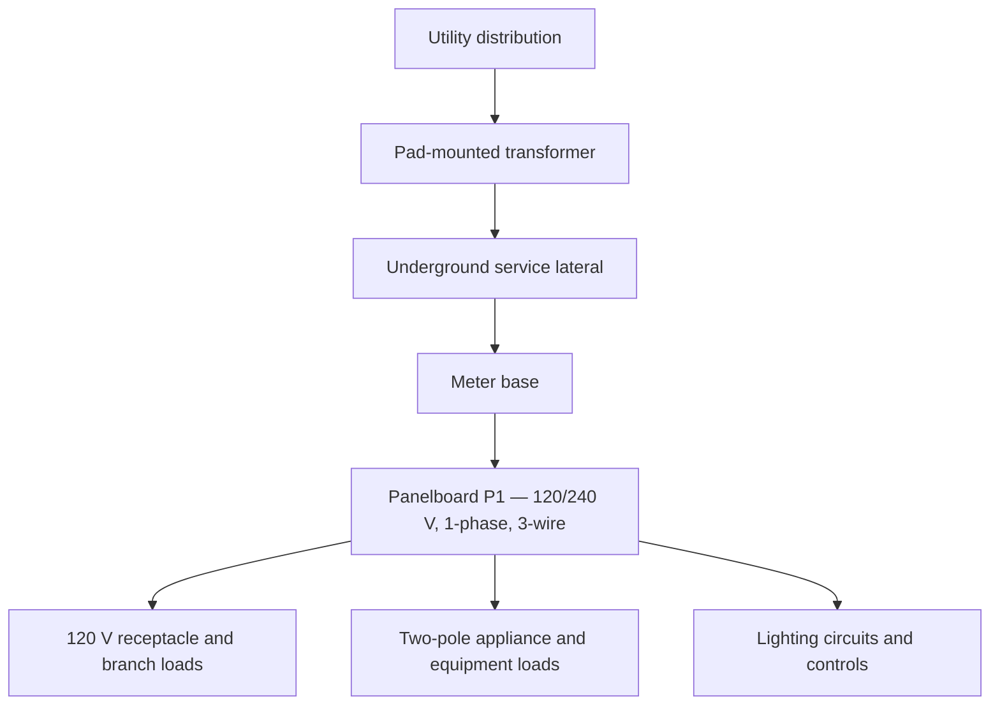

# Three-Bedroom Residential Electrical Design | Autodesk Revit MEP

**A BIM-based residential electrical design and documentation study using Autodesk Revit 2027.**

**Prepared by:** John Mark Obura  
**Software:** Autodesk Revit 2027  
**Project:** Three-bedroom residential building  
**Focus:** Building electrical power distribution, lighting and controls, service coordination, and electrical construction documentation  
**Status:** Educational / portfolio exercise — **not issued for construction**

**Jump to:** [Drawings](#explore-the-project) · [System Overview](#2-electrical-system-architecture) · [Power Plan](#4-power-and-receptacle-layout) · [Lighting Plan](#5-lighting-layout-switching-and-wiring) · [Panel P1](#6-panelboard-p1-and-branch-circuit-documentation) · [Skills](#10-skills-and-tools) · [Attribution](#acknowledgment-and-tutorial-attribution)

> **Project at a glance:** This repository records my hands-on work through a complete, tutorial-guided residential Revit MEP electrical workflow: coordinating the architectural and mechanical backgrounds, placing electrical devices, organizing branch circuits, representing lighting controls and wiring, documenting the site service, and preparing electrical drawings and schedules. The goal was to understand both how the electrical system is represented and how coordinated construction documents are produced in BIM software.

---

## Explore the Project

**Start with the drawing sheets:**

| Drawing | What it shows | Open |
|---|---|---|
| **E101 — Electrical Site Plan** | Building/site context, utility transformer, meter, service lateral, and equipment locations | [View E101 PDF](Electrical%20Sheets/E101%20-%20SITE%20PLAN%20ELECTRICAL%20SHEET.pdf) |
| **E201 — Lighting Plan** | Lighting-fixture placement, switching arrangements, lighting circuits, and annotations | [View E201 PDF](Electrical%20Sheets/E201%20-%20FLOOR%20PLAN%20LIGHTING%20SHEET.pdf) |
| **E301 — Power Plan** | Receptacles, appliance connections, equipment power, and circuit identification | [View E301 PDF](Electrical%20Sheets/E301%20-%20FLOOR%20PLAN%20-%20POWER%20SHEET.pdf) |

**Explore the standalone views:**

| View | Open |
|---|---|
| First-floor electrical power plan | [Power plan](Floor%20and%20Site%20plans/FLOOR%20PLAN%20-%20POWER.pdf) |
| First-floor electrical lighting plan | [Lighting plan](Floor%20and%20Site%20plans/FLOOR%20PLAN%20-%20LIGHTING.pdf) |
| Electrical site plan | [Site plan](Floor%20and%20Site%20plans/SITE%20PLAN%20-%20ELECTRICAL.pdf) |

**Revit project:** [Open the `.rvt` file](ER%20Tutorial%203-Bedroom%20Home%20ELECT%20R27.rvt)  
**Important:** The project references architectural and mechanical models supplied by the course creator. Those linked files are **not bundled here**, so Revit may report missing links until the original resources are obtained and their paths are repaired. See [Opening the model](#opening-the-revit-model).

---

## 1. Project Overview

Electrical systems in buildings require more than placing outlets and lights. The drawing set must relate the electrical devices to the building architecture, describe how equipment receives power, identify circuit assignments, and communicate installation intent through consistent symbols, tags, schedules, and diagrams.

This study follows that workflow for a three-bedroom residential house. It uses Revit's model-based documentation environment to represent:

- **Electrical power:** general-use receptacles, selected dedicated appliance connections, power equipment, and branch-circuit annotations.
- **Lighting:** ceiling and wall fixtures, recessed fixtures, switching devices, circuit assignments, and graphical wiring.
- **Distribution:** a residential loadcenter, circuit breakers, a panel schedule, and a simplified one-line diagram.
- **Site service:** the relationship between the utility transformer, meter location, underground service route, and panelboard.
- **Cross-discipline coordination:** electrical elements referenced against the architectural layout and linked mechanical equipment.

The drawings demonstrate a BIM documentation workflow; they are not evidence of a completed independent power-system calculation, protection study, or formal code review.

## 2. Electrical System Architecture

The project represents a typical **120/240 V, single-phase, three-wire residential distribution arrangement**. The principal distribution panel is identified as **P1**, located in the garage.

The project one-line and panel schedule present a **225 A panelboard/mains rating** and a **200 A main circuit-breaker (MCB) rating**. These are the values shown in the tutorial-based drawing and must be checked against actual equipment selections and applicable design requirements before any real installation.

**Key concept:** The one-line diagram summarizes electrical relationships and equipment ratings; the floor and site plans communicate where those components are located.

## 3. BIM Setup and Interdisciplinary Coordination

The model began with an architectural background and a separate mechanical model supplied for the tutorial. Working within this arrangement helped me practice:

1. **Linking models** instead of rebuilding the same architectural information in the electrical model.
2. **Establishing building levels and grid references** to coordinate electrical equipment with floor elevations and room locations.
3. **Using room tags, scope boxes, crop regions, and view ranges** to keep the plans readable and consistently framed.
4. **Managing view templates and visibility settings** so electrical plans and reflected ceiling plans display the right information.
5. **Coordinating device placement with walls, doors, plumbing equipment, and mechanical equipment**, rather than treating the electrical drawing as an isolated diagram.

A particularly useful lesson was learning that a family can display differently in a floor plan, a reflected ceiling plan, and a 3D view. Correct visibility, hosting, and annotation settings are essential when moving between these views.

## 4. Power and Receptacle Layout

**View the documentation:** [E301 — Power Sheet](Electrical%20Sheets/E301%20-%20FLOOR%20PLAN%20-%20POWER%20SHEET.pdf) · [Standalone Power Plan](Floor%20and%20Site%20plans/FLOOR%20PLAN%20-%20POWER.pdf)

The power plan documents receptacle placement relative to the room layout and selected equipment connections. Areas represented in the circuit documentation include the **kitchen, bathrooms, bedrooms, garage, laundry, and general living spaces**.

### Device and equipment representation

- Duplex receptacles and receptacle annotations.
- Kitchen receptacle groups and individually identified appliance loads.
- Bathroom and laundry connections.
- Dedicated or specially rated connections shown for equipment such as the **electric range, dryer, water heater, HVAC equipment, and EV charging**.
- Junction boxes and connection points for equipment such as exhaust fans.
- Mounting-height annotations, including **AFF (above finished floor)**, where shown.

### Technical principles applied

- Understanding the distinction between **120 V general-purpose branch circuits** and **two-pole 120/240 V appliance circuits**.
- Associating loads with circuit designations and the panel schedule.
- Recognizing why high-demand equipment may require a separate branch circuit and different breaker/conductor requirements.
- Keeping plan symbols and tags consistent with the actual Revit family types.

A notable example is the **electric range**, identified in the drawings with a **50 A** connection. The panel schedule also documents other two-pole equipment circuits. These figures describe the tutorial model; actual breaker, conductor, receptacle, and equipment selections must be confirmed against manufacturer data and adopted electrical codes.

## 5. Lighting Layout, Switching, and Wiring

**View the documentation:** [E201 — Lighting Sheet](Electrical%20Sheets/E201%20-%20FLOOR%20PLAN%20LIGHTING%20SHEET.pdf) · [Standalone Lighting Plan](Floor%20and%20Site%20plans/FLOOR%20PLAN%20-%20LIGHTING.pdf)

The lighting work was prepared using a **reflected ceiling plan** and coordinated with the architectural spaces. The model and electrical legend include examples of:

- Ceiling-mounted lighting.
- Recessed downlights.
- Wall sconces and pendant fixtures.
- Strip and under-cabinet lighting.
- Exterior/site lighting.
- Single-pole, three-way, and four-way switch symbols.

### Circuiting versus visible wiring

A major Revit skill developed in this project was learning to distinguish two separate tasks:

1. **Electrical circuit assignment:** placing compatible fixtures on a Revit electrical circuit and relating that circuit to a panel.
2. **Graphical wiring:** showing wire arcs, branches, home-run indicators, and conductor tick marks on the printed plan.

The visual wire path should not be mistaken for a complete physical conduit routing model or proof of a properly connected electrical system. Graphical connections, device connectors, and circuit membership each need to be checked in their proper context.

### Practical coordination challenges

This workflow required attention to small but important details: hosted family behavior, connector selection, reflected-ceiling visibility, correct fixture symbols, switch annotations, and wire-end/home-run symbols. These are precisely the coordination issues that can make a drawing appear correct while leaving its BIM relationships incomplete.

## 6. Panelboard P1 and Branch-Circuit Documentation

The panel schedule organizes loads by circuit number, breaker rating, number of poles, and description. It also identifies the panel location and nominal electrical system.

**Model information represented in the schedule:**

| Item | Documented value |
|---|---|
| Panel designation | **P1** |
| Panel location | **Garage** |
| Electrical system | **120/240 V, 1-phase, 3-wire** |
| Mounting | **Recessed** |
| Panel/mains rating shown | **225 A** |
| Main breaker (MCB) shown | **200 A** |

Circuit descriptions in the tutorial-based schedule include garage receptacles, dishwasher, dining receptacles, laundry, bathroom receptacles, bedroom receptacles, two kitchen receptacle circuits, refrigerator, microwave, garage lighting, and larger equipment loads such as the range and dryer.

### Skills demonstrated

- Assigning electrical equipment and fixtures to circuits in Revit.
- Naming and organizing circuits by served area or load.
- Distinguishing single-pole and two-pole breaker entries.
- Producing a panel schedule linked to the modeled electrical systems.
- Checking consistency between device annotations, panel designations, and the simplified one-line diagram.

**Engineering limitation:** The documented schedule is a drawing deliverable, not an independently validated NEC load calculation or protection-coordination study. Short-circuit calculations, available fault current, voltage-drop analysis, conductor sizing verification, and final panel-demand evaluation are outside the verified scope of this repository.

## 7. Site Electrical Distribution and One-Line Representation

**View the documentation:** [E101 — Electrical Site Sheet](Electrical%20Sheets/E101%20-%20SITE%20PLAN%20ELECTRICAL%20SHEET.pdf) · [Standalone Site Plan](Floor%20and%20Site%20plans/SITE%20PLAN%20-%20ELECTRICAL.pdf)

The electrical site plan represents the relationship between the **utility pad-mounted transformer**, **utility meter base**, **underground service lateral**, and **residential loadcenter P1**.

The broader model/documentation workflow includes:

- Positioning site electrical equipment relative to the building.
- Illustrating the underground service connection.
- Representing conduit routing and its relationship to electrical equipment.
- Using notes, labels, and leaders to identify equipment and service paths.
- Drawing a simplified **120/240 V, one-phase, three-wire one-line diagram**.

This helped connect the equipment visible on the site plan with the downstream panel and branch circuits shown in the building's power and lighting plans.

## 8. Electrical Symbols, Families, and Drawing Standards

An electrical drawing must be interpretable by someone who did not create it. For this reason, the project includes electrical-symbol and annotation work for:

- Receptacles and special-purpose electrical connections.
- Lighting fixture types and switch designations.
- Junction boxes and electrical equipment.
- Panelboards, meter equipment, and conduit representations.
- Common electrical abbreviations such as **AFF**, **DW**, and **LTS**.

I also worked with **Revit families and nested 2D annotation symbols** to understand why a receptacle may appear as a full 3D model in a legend but as a standard electrical symbol in a power plan. This included opening the receptacle family and identifying its nested **Duplex Annotation** family.

The experience reinforced the difference between **model geometry**, **plan symbols**, **annotation families**, **legend components**, and **schedules**—all of which serve distinct purposes in electrical documentation.

## 9. Documentation, Sheets, and PDF Export

The finished drawing presentation was organized into electrical sheets and standalone plans. The workflow covered:

1. Preparing power, lighting, and site views.
2. Applying appropriate view settings, tags, and legends.
3. Creating and arranging title-block sheets.
4. Placing schedules and drafting/legend views.
5. Exporting large-format drawings to PDF.
6. Reviewing PDF output for legibility and missing or faint model elements.

One practical troubleshooting lesson was the difference between **vector** and **raster** PDF output. Raster processing helped retain model geometry that had not appeared as expected in an earlier site-plan export; the remaining line appearance then required separate attention to halftone/graphics settings.

## 10. Skills and Tools

| Area | Skills practiced |
|---|---|
| **BIM / Revit MEP** | Project navigation, linked models, levels, grids, scope boxes, view templates, view ranges |
| **Electrical layouts** | Receptacle placement, equipment connections, mounting annotations, lighting fixture placement |
| **Circuit documentation** | Panel assignment, branch-circuit identification, single- and two-pole circuit representation |
| **Lighting controls** | Switch symbols, reflected ceiling plans, lighting circuits, wire arcs and home-run conventions |
| **Power distribution documentation** | Residential loadcenter, panel schedule, utility-to-panel one-line representation |
| **Interdisciplinary coordination** | Architectural, mechanical, and electrical model relationships |
| **Revit families** | Hosted devices, electrical connectors, nested generic annotations, legend representations |
| **Technical communication** | Schedules, electrical legends, labels, title blocks, drawing sheets, PDF publishing |
| **Troubleshooting** | Visibility/graphics overrides, missing linked references, printing and display issues |

**Primary software:** Autodesk Revit 2027. The study does not claim use of SKM, ETAP, OpenDSS, or a separate power-system simulation package.

## 11. Key Takeaways

This project helped move my understanding of residential electrical engineering beyond symbols on a floor plan. I gained practical appreciation for how device locations, electrical circuits, service equipment, schedules, and building-model coordination fit together in a single documentation workflow.

The most valuable lessons were:

- An **electrical drawing and an electrical calculation are not the same thing**; both matter, but they validate different aspects of a design.
- A correctly placed fixture in a model does not automatically mean that its **electrical connector, circuit assignment, and visible wiring** are all correct.
- Electrical designers must coordinate with architectural and mechanical information throughout the workflow.
- Clear symbols, schedules, and properly exported sheets are part of the engineering communication process, not cosmetic additions.
- Troubleshooting view templates, families, links, and PDF output is part of real BIM production work.

## 12. Project Scope and Next Steps

This repository documents the practical Revit MEP workflow completed as a **guided educational exercise**. It is **not a permitted, reviewed, or stamped construction design**. The project does not establish full compliance with any particular adopted edition of the National Electrical Code (NEC), local amendments, or the requirements of an authority having jurisdiction.

Future independent extensions could include:

- Verifying a complete dwelling load calculation and panel-demand schedule.
- Checking circuit conductor sizes, voltage drop, equipment interrupting ratings, and grounding/bonding requirements.
- Evaluating feeder sizing and coordination for the modeled service arrangement.
- Investigating modern lighting power and fixture-selection alternatives.
- Developing an independently designed residential or small commercial electrical system from a new set of requirements.

## Opening the Revit Model

1. Use **Autodesk Revit 2027** or a compatible newer release.
2. Download the [electrical project file](ER%20Tutorial%203-Bedroom%20Home%20ELECT%20R27.rvt).
3. Obtain the architectural and mechanical reference files from the **original course creator's authorized download**, where available.
4. Open the electrical model. If Revit reports missing links, go to **Manage → Manage Links → Revit** and reload the corresponding source models from their local paths.
5. Note that models saved in newer Revit versions generally cannot be opened directly in older Revit releases.

**Source-file note:** The supplied architectural, mechanical, and template materials are third-party teaching resources. They are not included in this repository's linked-model folder and are not independently relicensed here. Please refer to the original publisher for access and permitted use.

## Acknowledgment and Tutorial Attribution

This was a **tutorial-guided learning project**, not an independently originated architectural or electrical design. I followed the Revit MEP Electrical course presented by **Electric Rob / MFIA Inc. Consulting Engineers**, using architectural and mechanical models, an electrical template, and Revit families made available for course participants. My contribution was performing and troubleshooting the guided Revit electrical modeling, circuiting, view setup, documentation, legend work, and drawing export in Revit 2027.

**Original tutorial:** [Revit MEP Electrical — Complete Three-Bedroom Residential Design Course](https://www.youtube.com/watch?v=it5oK6iwgJg)  
**Course creator:** [MFIA Inc. Consulting Engineers](https://www.mfia-eng.com/)

The tutorial and original resources remain the work of their respective authors. Their availability for educational download should not be interpreted as permission to redistribute or relicense those materials. Any repository license applies only to material for which its author has the rights to grant that license.

---

**John Mark Obura**  
Electrical Engineering Student | Electrical Power Systems & Building Electrical Design
